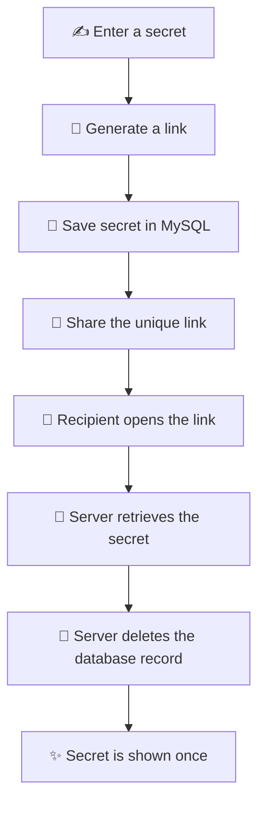

<div align="center">

# Gayebi Pass

### A little link for secrets that shouldn't stay forever. 🔐

**Share a secret once. Let it disappear after it's opened.**

[](https://react.dev/)
[](https://vitejs.dev/)
[](https://nodejs.org/)
[](https://www.mysql.com/)

*A tiny, simple one-time secret-sharing app made with care. 💌*

</div>

---

## 🎀 What is Gayebi Pass?

**Gayebi Pass** lets you turn a private message, password, PIN, or other text into a shareable one-time link.

Instead of sending sensitive text directly in a chat, you can:

1. ✍️ Paste your secret into the app.
2. 🔗 Generate a unique link.
3. 💌 Share that link with the intended recipient.
4. 👀 The recipient opens it and sees the secret.
5. 🫧 The secret is deleted from the database after it is retrieved.

The idea is simple: **one secret, one reveal, then it's gone.**

> [!NOTE]
> This repository currently implements **one-time secret sharing**, not time-based or SMS/email OTP generation. The project name contains “OTP Generator”, but the current application is branded **Gayebi Pass** and does not generate verification codes.

## ✨ Features

- 📝 **Create a secret link** — submit a password, PIN, or private text.
- 🪄 **Unique links** — each secret gets its own UUID-based URL.
- 📋 **Quick copy** — copy the generated link to your clipboard.
- 👁️ **One-time reveal** — retrieve a secret through its unique link.
- 🫥 **Vanishing secret** — the backend deletes the stored record after retrieval.
- ⚠️ **Expired-link feedback** — already-used or unknown links show an error.
- 🧩 **Simple full-stack setup** — React frontend, Express API, and MySQL storage.

## 🧸 How it works



The frontend sends the secret to the Express API. The server stores it in the `secrets` table with a UUID. When someone opens the corresponding `/secret/:id` page, the frontend requests that secret from the API. The server returns the text and deletes its database row.

## 🛠️ Built with

| Technology | What it does |
| --- | --- |
| [React 18](https://react.dev/) | Builds the user interface |
| [Vite 5](https://vitejs.dev/) | Frontend development and production builds |
| [Node.js](https://nodejs.org/) | JavaScript runtime |
| [Express 4](https://expressjs.com/) | Backend API |
| [MySQL](https://www.mysql.com/) | Stores secret records |
| [mysql2](https://sidorares.github.io/node-mysql2/) | Connects the server to MySQL |
| [UUID](https://www.npmjs.com/package/uuid) | Creates unique secret identifiers |
| [dotenv](https://www.npmjs.com/package/dotenv) | Loads local environment variables |

## 🌱 Getting started

Ready to run your own little secret-sharing garden? Follow these steps!

### 1. Prerequisites

Make sure you have:

- [Node.js](https://nodejs.org/) installed (with npm).
- [MySQL](https://www.mysql.com/) installed and running.
- Git installed.

### 2. Clone the repository

```bash
git clone https://github.com/aranna05/geyebipass-OTP-Generator-.git
cd geyebipass-OTP-Generator-
```

### 3. Install dependencies

```bash
npm install
```

### 4. Create the database

Run the SQL schema included in the project:

```bash
mysql -u root -p < schema.sql
```

This creates the `gayebi_pass` database and its `secrets` table.

If your MySQL account uses a different username, replace `root` with that username.

### 5. Configure environment variables

Create a `.env` file in the project root. You can start from `.env.example`:

```env
DB_HOST=localhost
DB_USER=root
DB_PASSWORD=your_mysql_password
DB_NAME=gayebi_pass
DB_PORT=3306

PORT=5000
```

Update the values to match your local MySQL configuration.

**Please keep `.env` private.** Never commit database passwords or other credentials to Git.

### 6. Start the backend

Open a terminal and run:

```bash
npm run server
```

The Express API will start on:

```text
http://localhost:5000
```

### 7. Start the frontend

Open a **second terminal** in the project directory:

```bash
npm run dev
```

Vite starts the frontend at:

```text
http://localhost:5173
```

Open that address in your browser and you're ready to go! 🌸

> The Vite development server proxies `/api` requests to `http://localhost:5000`, so keep the backend running while using the frontend.

## 🗂️ Project structure

```text
geyebipass-OTP-Generator-/
│
├── src/
│   ├── App.jsx          # Main React UI and secret-link flow
│   └── main.jsx         # React application entry point
│
├── dist/                # Production build output (generated)
├── schema.sql           # MySQL database and table definition
├── server.js            # Express API and MySQL connection
├── index.html           # HTML entry point
├── vite.config.js       # Vite config and API proxy
├── .env.example         # Example environment configuration
├── package.json         # Dependencies and npm scripts
└── README.md            # You are here! 💗
```

## 🔌 API endpoints

The backend currently exposes two endpoints:

| Method | Endpoint | Description |
| --- | --- | --- |
| `POST` | `/api/secrets` | Creates a secret record and returns its UUID |
| `GET` | `/api/secrets/:id` | Retrieves the secret and deletes its database record |

### Create a secret

**Request**

```http
POST /api/secrets
Content-Type: application/json
```

```json
{
  "secret_text": "my-private-message"
}
```

**Successful response** (`201 Created`)

```json
{
  "id": "generated-uuid"
}
```

If `secret_text` is missing or empty, the API responds with `400 Bad Request`.

### Retrieve a secret

**Request**

```http
GET /api/secrets/generated-uuid
```

**Successful response**

```json
{
  "secret_text": "my-private-message"
}
```

The corresponding database record is deleted after retrieval. If the ID does not exist (including a link that has already been used), the API responds with `404 Not Found`:

```json
{
  "error": "Link expired or already vanished"
}
```

## 📦 Available scripts

| Command | Description |
| --- | --- |
| `npm run dev` | Starts the Vite development server |
| `npm run server` | Starts the Express backend with Nodemon |
| `npm run build` | Builds the frontend for production |
| `npm run preview` | Previews the production frontend build |

To create a production frontend build:

```bash
npm run build
```

The generated frontend files are placed in `dist/`.

## 🛡️ A little security note

Gayebi Pass is a small project demonstrating one-time secret sharing. **One-time deletion is not the same as end-to-end encryption or guaranteed secure secret delivery.**

Before using it for real credentials or sensitive information, keep these limitations in mind:

- **Secrets are stored as plain text** in the current MySQL implementation; encryption at rest or application-level encryption is not implemented.
- **Use HTTPS in production** so secrets are protected while travelling between the browser and server.
- **Anyone with the link can attempt to open it.** Treat the link like a password and share it only with the intended recipient.
- **The current retrieval flow uses separate database read and delete queries.** It is not an atomic, concurrency-safe consume operation; simultaneous requests may need stronger handling.
- **Add rate limiting, input-size limits, validation, and careful error handling** before exposing the service publicly.
- **Avoid logging secret contents** and protect database backups and access.
- **Configure CORS and deployment settings deliberately** rather than relying on broad development defaults.

Please don't use the current version as a secure vault or send highly sensitive production credentials through it without additional security work.

## 🌷 Future ideas

A few things that could make this little project even lovelier:

- [ ] Add optional expiry times for secret links.
- [ ] Add password-protected secret links.
- [ ] Encrypt secrets before storing them.
- [ ] Make retrieval atomic so a secret can only be consumed once, even with simultaneous requests.
- [ ] Add rate limiting and stronger input validation.
- [ ] Add automated tests for the API and user interface.
- [ ] Add a polished success, loading, and error experience.

## 🤝 Contributing

Ideas, bug reports, and improvements are always welcome! 💗

1. Fork the repository.
2. Create a branch for your change.
3. Make your changes and test them locally.
4. Open a pull request with a little explanation of what you improved.

## 💌 A little note

Made with curiosity, code, and a sprinkle of magic. ✨

If Gayebi Pass made you smile, consider giving the repository a ⭐ on GitHub!

<div align="center">

**Thanks for stopping by!**

🌸 Keep your secrets safe. Keep your code lovely. 🌸

</div>
